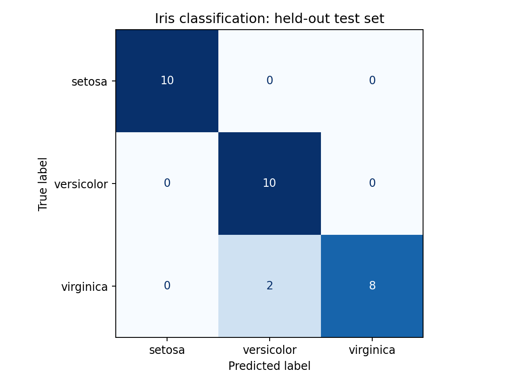
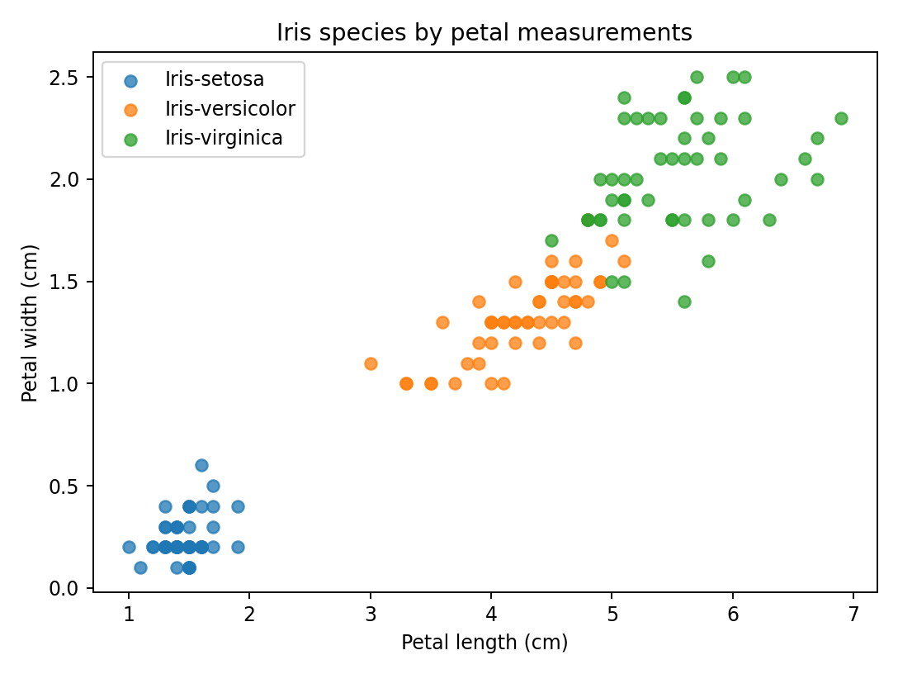

# Iris Flower Classification

## Introduction
The objective was to train a machine learning model to classify an Iris flower as setosa, versicolor, or virginica from its sepal and petal measurements. This is supervised multiclass classification: the model learns from examples whose species labels are already known.

## Dataset and preparation
The supplied Iris.csv contains 150 flowers, with 50 examples of each species. The four input features are sepal length, sepal width, petal length, and petal width, measured in centimetres. Species is the target label. No missing values were found. The Id column was excluded because it identifies records rather than describing flower measurements.

A stratified 80:20 split produced 120 training records and 30 test records, preserving class balance (40 training and 10 test records per species). The random seed was 42 so the split can be reproduced.

## Model and method
Scikit-learn was used to build a pipeline containing StandardScaler and a K-Nearest Neighbours classifier with k=5. KNN predicts the majority species among the five nearest training flowers. Standardisation gives each measurement a comparable scale so that differences in numeric spread do not dominate distance calculations.

Five-fold stratified cross-validation was performed only on the training data. In each fold, four parts were used to fit the pipeline and one part to validate it. Scaling was fitted separately within each fold to prevent leakage. The fixed model was then fitted on all 120 training records and evaluated on the untouched 30-record test set. No test-driven parameter tuning was performed.

## Results
The model correctly classified 28 out of 30 test flowers.

| Measure | Result |
|---|---:|
| Test accuracy | 93.33% |
| Training cross-validation mean accuracy | 95.83% |
| Cross-validation standard deviation | 2.64 percentage points |
| Macro F1-score | 0.9327 |

| Species | Precision | Recall | F1-score | Test samples |
|---|---:|---:|---:|---:|
| Setosa | 1.0000 | 1.0000 | 1.0000 | 10 |
| Versicolor | 0.8333 | 1.0000 | 0.9091 | 10 |
| Virginica | 1.0000 | 0.8000 | 0.8889 | 10 |

Confusion matrix (rows = actual species; columns = predicted species):

| Actual / Predicted | Setosa | Versicolor | Virginica |
|---|---:|---:|---:|
| Setosa | 10 | 0 | 0 |
| Versicolor | 0 | 10 | 0 |
| Virginica | 0 | 2 | 8 |

The two errors were virginica flowers predicted as versicolor. The petal scatter plot shows overlap between these two species, which helps explain the errors; setosa is more clearly separated.

## Basic classification concepts
- Features: measured inputs used to make predictions.
- Target: the species the model must predict.
- Training data: labelled examples used to fit the model.
- Test data: held-out examples used to assess generalisation.
- Accuracy: correct predictions divided by all predictions (28/30).
- Precision: among predictions for a species, the fraction that are correct.
- Recall: among actual flowers of a species, the fraction found correctly.
- F1-score: the harmonic mean of precision and recall, balancing both measures.
- Overfitting: learning training-specific details that do not generalise well to unseen examples. Held-out testing and cross-validation help assess this risk.

## Conclusion and limitations
The task was completed using the supplied data and Scikit-learn. A scaled KNN classifier achieved 93.33% accuracy on the held-out test set and 95.83% average training cross-validation accuracy. These results demonstrate effective classification on this small dataset, but 30 test samples do not establish performance on all real-world flowers. The system recognises only the three trained species and assumes correctly measured inputs in centimetres. Future work could compare classifiers and assess them through a separate validation strategy while preserving a final untouched test set.
